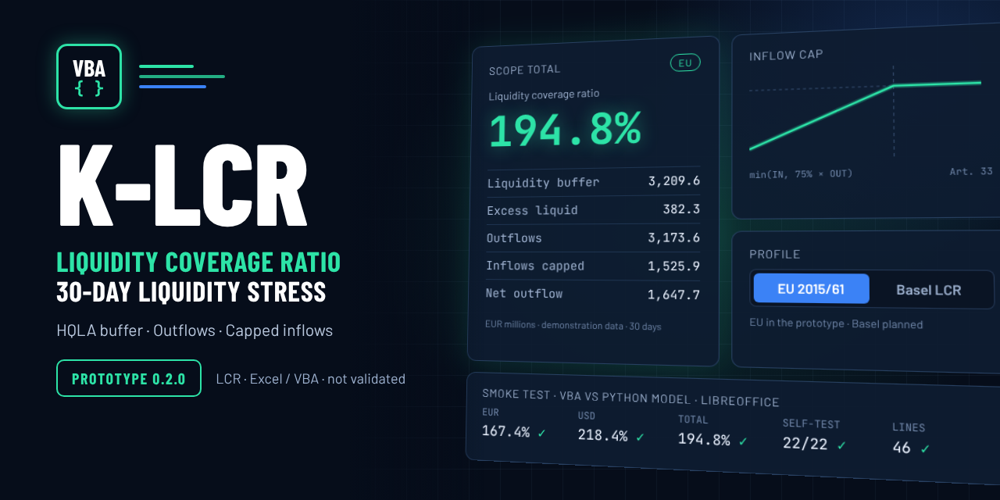

<div align="center">

# 💧 K-LCR

### Liquidity Coverage Ratio reference and independent validation in Excel VBA

**Separate EU and Basel profiles · Traceable inputs and outputs · Synthetic data only**

<br>

[](INSTALLATION.md#host-matrix)
[](INSTALLATION.md#host-matrix)
[](docs/REPOSITORY_STRUCTURE.md#-regulatory-profiles)
[](#-status)
[](LICENSE)

<br>

[](docs/TRAFFIC.md#badges)
[](docs/TRAFFIC.md#badges)
[](docs/TRAFFIC.md#badges)

<br>

[Website](https://danielep71.github.io/K-LCR/) · [Wiki](https://github.com/danielep71/K-LCR/wiki) ·
[Status](#-status) · [What this project is](#-what-this-project-is) ·
[Get started](#-get-started) · [Architecture](#%EF%B8%8F-architecture) ·
[Layout](#-repository-layout) · [Documentation](#%EF%B8%8F-documentation) ·
[Contributing](CONTRIBUTING.md) · [Limitations](#%EF%B8%8F-limitations)

---

<p align="center">
  
</p>

---

</div>

## 📍 Status

> [!IMPORTANT]
> **Prototype.** A [prototype workbook](docs/PROTOTYPE.md) of the EU
> profile is in the repository: it calculates an LCR, and nothing validates
> it. There is no validated workbook, Excel import/compile run or supported
> host claim yet.
> Windows desktop Excel 64-bit is an **engineering target**, not a tested
> configuration. This project is intended for reference and independent
> validation, not operational reporting or production use.

The selected implementation is Excel/VBA with separate planned EU and Basel
profiles. The portable **Repository integrity** check covers repository
tooling, Python lint and types, tracked text, workflows, the input and
parameter contracts, the registered test cases, static VBA rules, binary files
and the changelog. It does not validate regulatory
calculations or execute Excel. The figures in the image above are regulatory
requirements, with their sources in [docs/assets](docs/assets/README.md#-social-preview),
not results.

## ✨ What this project is

K-LCR is planned as an auditable Liquidity Coverage Ratio reference. The
design separates regulatory source and parameter choices, deterministic
calculation, public API and Excel input/output. Synthetic fixtures and
independent expected values will support validation as those components are
implemented. The source editions, the applicability decisions, the input,
parameter and result contracts and the test-case rules are already defined in
[docs/methodology](docs/methodology/README.md); the calculation is not.

### Where K-LCR belongs

K-LCR adds liquidity risk to the
[K-Risk Engines](https://github.com/danielep71/K-Risk-Engines) portfolio of
independent risk calculators, whose other projects cover counterparty credit,
market, CVA and interest-rate risk. A prototype of the EU profile exists; no
validated LCR result exists yet.

## 📥 Get started

Clone the repository, switch to the active integration branch and run the
repository checks:

```sh
git clone https://github.com/danielep71/K-LCR.git
cd K-LCR
git switch release/0.1.0
python tools/check.py --ci
```

The check needs Python 3.13, Node.js 22, actionlint and the hash-locked Ruff,
mypy and PyYAML; [Installation](INSTALLATION.md#developer-setup) gives the
steps, which I verified from a fresh clone. Every gate should report PASS,
and the report goes to `test-results/`. No workbook is available to install.
Do not treat a static PASS as Excel or LCR evidence. To contribute, read
[CONTRIBUTING.md](CONTRIBUTING.md).

## 🏗️ Architecture

| Boundary | Planned role | Current state |
| --- | --- | --- |
| Pure VBA core | Deterministic calculation, with explicit profile and parameter versions | Contract only |
| Public API | Request validation, named errors and results | Contract only |
| Excel adapter | Host I/O and state restoration | Contract only |
| Validation | Independent fixtures and real host evidence | Case format and plan defined (#11); host evidence planned under #15 |

See [scope and architecture](docs/REPOSITORY_STRUCTURE.md) and
[VBA house style](docs/VBA_HOUSE_STYLE.md) for the boundaries.

## 🧱 Repository layout

| Path | Holds |
| --- | --- |
| `docs/` | Governance, scope and decisions, settings evidence, the VBA house style and the website |
| `docs/methodology/` | Source register, applicability map, contracts, test-case rules, validation plan and the stored EU source copies |
| `tests/contract/`, `tests/parameters/`, `tests/cases/`, `tests/derivations/` | Synthetic fixtures for the contracts and the registered test cases |
| `tools/` | `check.py` and its gates, with their tests |
| `.github/` | Labels, issue forms, the pull request template, Dependabot and the workflows |
| `tests/unit/` | The neutral VBA test harness and its example suite: source only, not yet compiled or run in Excel |
| `src/core/`, `src/modules/`, `src/workbook/`, `tests/modules/` | The [prototype workbook](docs/PROTOTYPE.md): its VBA source, its macro-free template and its self-test; not validated |
| `src/api/`, `src/host/excel/`, `tests/host/` | Planned API, Excel adapter and host tests; not created yet |

The full layout, with the planned paths, is in
[REPOSITORY_STRUCTURE.md](docs/REPOSITORY_STRUCTURE.md#%EF%B8%8F-repository-layout).

## 🗂️ Documentation

| Topic | Read |
| --- | --- |
| Scope, decisions and follow-on work | [Architecture](docs/REPOSITORY_STRUCTURE.md) · [Decisions](docs/DECISIONS.md) |
| Regulatory sources and applicability | [Source register](docs/methodology/SOURCES.md) · [Applicability map](docs/methodology/APPLICABILITY.md) |
| Contracts, test cases and validation | [Input contract](docs/methodology/DATA_CONTRACT.md) · [Parameter sets and results](docs/methodology/PARAMETERS_AND_RESULTS.md) · [Test cases](docs/methodology/TEST_CASES.md) · [Validation plan](docs/methodology/VALIDATION_PLAN.md) |
| Contributing and conduct | [Contributing](CONTRIBUTING.md) · [Code of conduct](CODE_OF_CONDUCT.md) |
| Development, review and checks | [Governance](docs/GOVERNANCE.md) · [Repository tooling](tools/README.md) · [Working rules](AGENTS.md) |
| Changes, versions and releases | [Changelog](CHANGELOG.md) · [Releasing and milestones](RELEASING.md) |
| Settings, evidence, verification gaps | [Repository settings](docs/REPOSITORY_SETTINGS.md) · [Settings evidence](docs/REPOSITORY_SETTINGS_EVIDENCE.md) · [Traffic history](docs/TRAFFIC.md) |
| Source files and generated artifacts | [Source control](docs/SOURCE_CONTROL.md) |
| VBA and Excel target | [Prototype workbook](docs/PROTOTYPE.md) · [House style](docs/VBA_HOUSE_STYLE.md) · [Installation](INSTALLATION.md) |
| License, provenance and safe examples | [Notice](NOTICE.md) · [Security](SECURITY.md) |

## ⚠️ Limitations

No numerical method, regulatory interpretation, host compatibility or
production readiness is certified. EU and Basel rules must remain distinct;
future calculations require source editions, reporting dates and parameter
versions. All examples and test data must be synthetic.

All development first targets `release/0.1.0`. Integration into `main`
requires my explicit authorization; see [governance](docs/GOVERNANCE.md).

## 👤 Author

**Daniele Penza** — [@danielep71](https://github.com/danielep71). This is an
independent personal project.

## 📄 License

[Mozilla Public License 2.0](LICENSE). Provenance of imported material is
recorded in [NOTICE](NOTICE.md).
